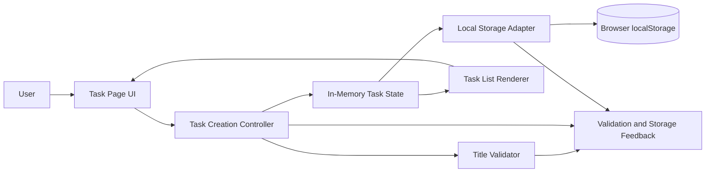

# Architecture — Create a TODO Task

Based on: docs/requirements.md v1   Version: 2   Status: Draft

## 1. Context & Goals

This design describes a local, single-user browser application for creating tasks and restoring them after refresh. The main drivers are the create/validate/display behavior (FR-1–FR-7), browser-local persistence (FR-8–FR-9), safe rendering (NFR-1), immediate and responsive feedback (NFR-2–NFR-4), storage recovery (NFR-5–NFR-6), and independently verifiable behavior (NFR-7). Human clarifications recorded in `.sdlc/state.md` resolve the prior validation and recovery questions: empty and whitespace-only titles use the exact message `Task title is required and cannot be empty.`, titles are limited to 255 characters without truncation, and unreadable whole storage data loads zero tasks while recoverable valid distinct records in partially malformed arrays are preserved.

No application source or build/configuration is present in the workspace; the proposal is therefore a minimal browser-only implementation.

## 2. Technology Choices

| Concern | Options considered | Decision | Rationale (FR/NFR ids) |
|---|---|---|---|
| Browser implementation | (1) Vanilla HTML, CSS, and JavaScript; (2) a client framework such as React or Vue | Use plain browser technologies | No existing framework or source exists, and the interaction is small and single-page (FR-1–FR-9). Avoiding an additional framework and build layer keeps the design proportionate and testable (NFR-7). |
| State ownership | (1) One in-memory task-state owner coordinated with persistence; (2) framework-managed state with persistence effects | Use a single in-memory state owner and explicit storage adapter | One state owner coordinates immediate list updates with persistence and prevents duplicate commits on repeated rendering (FR-5, FR-8, NFR-6). |
| Browser persistence | (1) `localStorage`; (2) `IndexedDB` | Use one JSON value in `localStorage` | Browser-local persistence is required and server storage is excluded (FR-8–FR-9). One small value keeps the implementation simple; IndexedDB transactions and schema machinery are unnecessary for this scope (NFR-5–NFR-7). |
| Task identity and storage format | (1) Title/status records with title-based deduplication; (2) records with unique IDs, title, and status | Store an array of `{id, title, status}` records; generate a unique ID per successful submission | IDs let restoration retain distinct tasks even when titles match, while detecting duplicate records by ID rather than discarding legitimate repeated titles (FR-3, FR-8–FR-9, NFR-6). |
| Title validation | (1) Reject only empty/whitespace titles; (2) also enforce a 255-character maximum | Reject empty/whitespace titles and titles longer than 255 Unicode code points; never truncate | Implements the human clarification consistently at creation time and during record recovery (FR-3–FR-4, NFR-2, NFR-6). |
| Storage writes | (1) Mutate UI state before attempting persistence; (2) write a candidate snapshot and commit memory only after success | Write one candidate JSON value, then commit in-memory state only when `setItem` succeeds | A failed write leaves the visible state unchanged and avoids claiming success without persistence (FR-5, FR-7–FR-8, NFR-5–NFR-6). A single-key write is the smallest available atomic update boundary. |
| Task rendering | (1) DOM text APIs such as `textContent`; (2) HTML-string interpolation | Use DOM text APIs only | Titles are untrusted; text-only rendering prevents title text from executing as markup or script (NFR-1). |
| Responsive layout | (1) One flexible CSS layout; (2) separate mobile and desktop implementations or a layout framework | Use one responsive CSS layout | Keeps controls operable at both required widths without duplicate behavior (NFR-4). |

## 3. Component Diagram



## 4. Components & Responsibilities

| Component | Responsibility | Inputs | Outputs | Covers (FR/NFR) |
|---|---|---|---|---|
| Task Page UI | Presents title input, Add Task action, task list, and visible validation/storage feedback | User input and actions; component results | Accessible, responsive page controls and status areas | FR-1, FR-2, FR-5, FR-7, NFR-2–NFR-4 |
| Title Validator | Rejects an empty or whitespace-only title and any title over 255 Unicode code points; uses trim only to detect whitespace-only input and preserves otherwise-valid entered text | Raw title string | Valid title or validation category/message | FR-3–FR-4, NFR-2, NFR-6 |
| Task Creation Controller | Coordinates submit-once behavior, validation, candidate persistence, state commit, render, feedback, and input clearing only on success | Raw title and Add Task action | Creation result; state and UI updates | FR-3–FR-8, NFR-2–NFR-3, NFR-6 |
| In-Memory Task State | Owns ordered task records; accepts restored state and commits a new record only after successful storage write | Restored records or storage-confirmed candidate | Current snapshot for rendering and persistence | FR-5–FR-6, FR-8–FR-9, NFR-5–NFR-6 |
| Local Storage Adapter | Reads and validates the whole stored value, recovers valid distinct array records, writes one candidate snapshot, and translates browser exceptions to storage errors | Read request or candidate record array | Restored records plus recovery status; write success or failure | FR-8–FR-9, NFR-5–NFR-6 |
| Task List Renderer | Renders every task title as text and displays its incomplete status | Ordered task snapshot | Task-list DOM entries | FR-5–FR-6, FR-9, NFR-1, NFR-3 |
| Validation and Storage Feedback | Shows the exact validation text and a clear user-visible storage error when storage is unavailable or data is unreadable/partially malformed | Validator and adapter status | Visible feedback text/status | FR-4, NFR-2, NFR-6 |
| Responsive Layout | Keeps task controls visible and operable at the target desktop and mobile widths | Viewport dimensions | Responsive page presentation | NFR-4 |

## 5. Data Flow

```mermaid
sequenceDiagram
  actor User
  participant UI as Task Page UI
  participant A as Local Storage Adapter
  participant S as In-Memory Task State
  participant R as Task List Renderer
  participant C as Task Creation Controller
  participant V as Title Validator
  participant F as Validation and Storage Feedback

  Note over UI,A: Initial page load
  UI->>A: Read task value
  alt Key absent (normal no-data state)
    A-->>S: Empty task list
  else Readable valid array
    A-->>S: Valid distinct records; skip duplicate IDs
  else Unreadable whole value (read exception, invalid JSON, wrong top-level shape)
    A-->>S: Empty task list
    A-->>F: Storage error
  else Partially malformed array
    A-->>S: Preserve valid distinct records; skip invalid/duplicate-ID records
    A-->>F: Storage error
  end
  S->>R: Render snapshot

  Note over User,F: Add Task
  User->>UI: Enter title and activate Add Task
  UI->>C: Submit once
  C->>V: Validate raw title
  alt Empty or whitespace-only
    V-->>C: Invalid; exact required message
    C->>F: Show validation feedback
  else Longer than 255 Unicode code points
    V-->>C: Invalid; title-length feedback
    C->>F: Show validation feedback
  else Valid (1–255 code points)
    V-->>C: Preserve title unchanged
    C->>S: Build candidate with unique ID and incomplete status
    S->>A: Write candidate JSON snapshot
    alt Write succeeds
      A-->>S: Confirm
      S->>R: Commit and render snapshot
      C->>UI: Clear input
    else Write fails
      A-->>C: Storage error; no commit
      C->>F: Show clear storage error
      Note over C,UI: Keep existing list and input unchanged
    end
  end
```

On startup, an absent key is a normal empty state. A read exception, empty/unparseable stored text, or non-array top-level value is unreadable as a whole: load zero tasks and show a storage error. For a parseable array, validate elements independently. Preserve valid records with distinct IDs, including records that share a title; skip malformed records and repeated IDs, and show a storage error if any record was skipped. Loading never writes data back automatically.

On submission, validate the original title before generating a task. Whitespace-only detection does not modify the title of a valid task. A title of exactly 255 Unicode code points is accepted; a title with 256 or more is rejected with clear length feedback and is never silently truncated. The controller creates a candidate record and writes the candidate array before committing it to visible state. It clears the input only after persistence succeeds.

Failure behavior:

- **Empty or whitespace-only title:** create nothing, do not write storage, retain the input, and show exactly `Task title is required and cannot be empty.` in the same interaction.
- **Overlength title:** create nothing, do not write storage, retain the input, and show clear feedback that the maximum is 255 characters; do not truncate.
- **Unavailable read or unreadable whole value:** load zero tasks and show a clear storage error; do not crash.
- **Partially malformed array:** preserve valid distinct records, skip invalid elements and duplicate IDs, and show a clear storage error.
- **Unavailable/failed write:** treat the update as failed atomically: do not commit the candidate to in-memory state or render it, do not clear the input, retain the existing list, and show a clear storage error. The adapter issues one `setItem` for the whole candidate value and does not expose a partially written application snapshot.
- **No saved task data:** an absent key renders an empty list without inventing tasks.
- **Missing task lookup:** this story has no task-detail lookup operation. If a requested task or persisted task record is explicitly looked up and does not exist, render the required literal `Not Found`; never synthesize a task from a missing record.

## 6. Data Model / File Formats

Persist one JSON array under one origin-specific `localStorage` key:

```json
[
  {
    "id": "generated-unique-id",
    "title": "Complete Java revision",
    "status": "incomplete"
  }
]
```

- `id` is generated uniquely for each successful submission and is used to distinguish tasks with identical titles and to detect repeated records during recovery.
- `title` is untrusted text with 1–255 Unicode code points. A title containing only whitespace is invalid; valid titles are preserved as entered rather than trimmed or truncated.
- `status` is `incomplete` for newly created tasks. `Not Found` is a missing-lookup presentation, not a stored task status.
- An absent storage key means no saved tasks. Present empty text, invalid JSON, a non-array top-level value, or a read exception is unreadable whole data and loads zero tasks with a storage error.
- In an array, a usable record must have a nonempty unique string ID, a string title satisfying the title rules, and status `incomplete`. Invalid records and repeated IDs are skipped; all valid distinct records are preserved. Any skipped entry raises a user-visible storage error.
- A successful write replaces the one candidate JSON value in one storage operation. In-memory state changes only after that operation succeeds.

## 7. Error Handling Strategy

The title validator is the sole create-form validation path. It first rejects titles whose trimmed content is empty using the exact message `Task title is required and cannot be empty.` It then counts Unicode code points and rejects titles above 255 with a clear maximum-length message. It does not truncate or alter valid title text.

The storage adapter catches browser read/write exceptions and reports a generic, user-understandable storage error without exposing exception details or browser internals. Whole-value read failures produce zero tasks. Parseable arrays are recovered record by record: keep valid records with unique IDs, skip malformed entries and repeated IDs, and report a storage error when anything is skipped. Read recovery is non-destructive; it does not rewrite or discard the original stored value.

Writes are staged as a complete candidate array and submitted in a single `localStorage.setItem`. The state owner and renderer commit only on success. A write exception leaves the current page state and input intact and reports failure, preventing a failed creation from appearing successful. Empty-state, validation, and storage feedback are distinct so a storage problem is not mistaken for title validation.

When a lookup is performed for a task that is absent, its presentation is `Not Found`; absence is never converted into a task record.

## 8. Security Considerations

- Task titles are untrusted and rendered only with DOM text APIs; do not interpolate them into HTML or execute/parse their contents.
- Enforce title validation both on user creation and on restored records. Validation does not make browser storage a trust boundary.
- Use only origin-local storage; no credentials, authentication data, private hosts, or external services are introduced.
- No runtime third-party package is needed. Any later dependency must be justified and pinned.
- Grant no server or elevated browser permissions. Keep storage error messages generic and do not expose exception details.
- A 255-code-point maximum is a usability/data-integrity rule, not a security guarantee. A script already running in the origin can access local storage.

## 9. Testing Strategy

| Requirement | Test coverage |
|---|---|
| FR-1, FR-2 | Page-load tests verify the title input and Add Task control are available. |
| FR-3 | Submit a valid title once and verify exactly one record and visible task are created. |
| FR-4, NFR-2 | Independently test empty and whitespace-only inputs; assert no write/task and the exact message `Task title is required and cannot be empty.` appears in the same interaction. |
| FR-3, NFR-7 | Test lengths of 255 and 256 Unicode code points: 255 succeeds unchanged; 256 is rejected, retained in the input, and is not truncated or persisted. Include supplementary Unicode characters to verify code-point counting. |
| FR-5, NFR-3 | Verify successful creation appears in the list during the same interaction without reload. |
| FR-6 | Verify new records and displayed items have incomplete status. |
| FR-7 | Verify successful write clears input; validation and storage failures do not clear it. |
| FR-8 | Storage integration tests verify one successful candidate snapshot contains the new record and prior records; failed writes do not commit a task. |
| FR-9, NFR-5 | Refresh tests use the real adapter and verify all successfully saved records restore under supported browser storage conditions. |
| NFR-1 | Seed HTML/script-like titles and verify they render as literal text with no script execution. |
| NFR-4 | Exercise 320-pixel portrait and 1280-pixel desktop viewports; verify controls remain visible and operable. |
| NFR-6 | Test absent key; read exception; present empty text; invalid JSON; wrong top-level shape; malformed array entries; repeated IDs; valid records with identical titles but distinct IDs; and write exception. Assert zero tasks for unreadable whole data, preservation of every valid distinct array record, visible storage error when data is unreadable/partially malformed or a write fails, no crash, and no partial UI commit on write failure. |
| NFR-7 | Keep creation, validation, persistence, refresh, rendering, and responsive tests independently repeatable and map test names/results to the corresponding requirement IDs. |

Use hermetic DOM/browser-storage fixtures without network access or real credentials. Integration tests should exercise the actual controller, state owner, renderer, and adapter together. Check the architecture/requirements traceability and verify `Not Found` is a missing-lookup presentation rather than a stored status.

## 10. Project Structure

No application source, framework, package manager, or build configuration exists in the workspace. The minimal proposed implementation layout is:

```text
src/
  index.html
  styles.css
  app.js                 # page wiring and responsive presentation hooks
  task-controller.js     # create/submit flow and input clearing
  title-validator.js     # empty/whitespace and 255-code-point rules
  task-state.js          # ordered in-memory task records
  task-storage.js        # localStorage read/recovery/write boundary
  task-renderer.js       # text-only task rendering
tests/
  title-validator.test.js
  task-controller.test.js
  task-storage.test.js
  task-renderer.test.js
```

This is a proposed separation of responsibilities, not a claim that these files already exist. Avoid adding a framework or build system unless implementation constraints require it.

## 11. Risks & Open Questions

Risks:

- Browser storage can be disabled, full, blocked by privacy settings, or unavailable for an origin. Reads/writes must surface the defined user-visible storage error.
- Browser APIs and Unicode handling must use the same code-point counting rule for creation and restoration.
- Multiple tabs can concurrently replace the same key; cross-tab synchronization is not specified and is not guaranteed by this design.
- `.sdlc/state.md` records clarifications that are not yet reflected in `docs/requirements.md` v1, whose assumptions/open items still say validation wording, maximum length, and recovery are unspecified. This architecture treats the approved human clarifications as decisions for Stage 2; requirements synchronization remains a documentation risk.

There are no unresolved architecture questions from the approved human clarifications. The requirements source still contains stale pre-clarification open items; this stage is limited to `docs/architecture.md` and does not alter that source.

## 12. Requirement Coverage

| Requirement | Component(s) |
|---|---|
| FR-1 | Task Page UI |
| FR-2 | Task Page UI |
| FR-3 | Task Creation Controller, Title Validator, In-Memory Task State, Local Storage Adapter |
| FR-4 | Title Validator, Validation and Storage Feedback, Task Page UI |
| FR-5 | Task Creation Controller, In-Memory Task State, Task List Renderer, Task Page UI |
| FR-6 | In-Memory Task State, Task List Renderer |
| FR-7 | Task Creation Controller, Task Page UI, Validation and Storage Feedback |
| FR-8 | Task Creation Controller, In-Memory Task State, Local Storage Adapter |
| FR-9 | Local Storage Adapter, In-Memory Task State, Task List Renderer |
| NFR-1 | Task List Renderer, Title Validator |
| NFR-2 | Title Validator, Validation and Storage Feedback, Task Page UI |
| NFR-3 | Task Creation Controller, Task List Renderer, Task Page UI |
| NFR-4 | Task Page UI, Responsive Layout |
| NFR-5 | Local Storage Adapter, In-Memory Task State |
| NFR-6 | Local Storage Adapter, Task Creation Controller, In-Memory Task State, Validation and Storage Feedback |
| NFR-7 | Testing Strategy, Task Creation Controller, Title Validator, Local Storage Adapter, Task List Renderer |

## 13. Revision History

| Version | Date | Change | Trigger (review finding / human request) |
|---|---|---|---|
| 1 | 2026-11-19 | Initial architecture for requirements v1 | Stage 2 architecture request; G1 approved |
| 2 | 2026-11-19 | Resolved prior validation and storage open questions; set exact empty/whitespace message, 255-code-point maximum with rejection/no truncation, whole-value unreadable recovery to zero tasks, partial-array valid-record recovery, unique-record identity, atomic write behavior, and corresponding flows, roles, error handling, and tests; removed stale architecture assumptions | Stage 2 human clarifications recorded in `.sdlc/state.md` |
