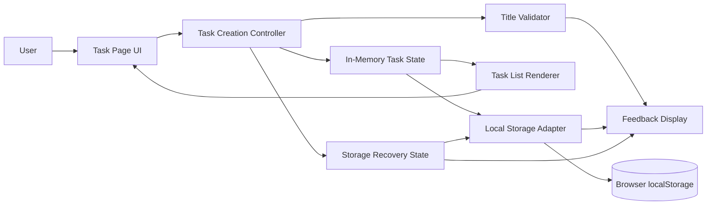

# Architecture — Create a TODO Task

Based on: docs/requirements.md v3   Version: 3   Status: Draft

## 1. Context & Goals

This design defines a minimal browser-only application that creates, validates, displays, and restores incomplete tasks. The principal requirement drivers are title entry and creation (FR-1–FR-3), exact validation feedback (FR-4 and FR-10), immediate display and input clearing (FR-5–FR-7), browser persistence and restoration (FR-8, FR-9, NFR-5), unreadable and unwritable storage behavior (NFR-6), text-only rendering (NFR-1), responsive usability (NFR-2–NFR-4), testability (NFR-7), and absence of credentials (NFR-8).

No application source or build configuration exists in the workspace. The design therefore uses plain HTML, CSS, and JavaScript and introduces no framework or backend.

## 2. Technology Choices

| Concern | Options considered | Decision | Rationale (FR/NFR ids) |
|---|---|---|---|
| Browser implementation | (1) Vanilla HTML, CSS, and JavaScript; (2) React or another client framework | Use plain browser technologies | The interaction is a small single-page flow and no existing framework is present (FR-1–FR-10). Vanilla code reduces dependencies and is directly testable (NFR-7). |
| State ownership | (1) A single in-memory task-state owner; (2) framework-managed state and persistence effects | Use one in-memory task-state owner plus one storage adapter | This gives one place to order tasks and commit state only after persistence succeeds (FR-5, FR-8, FR-9, NFR-6). |
| Persistence | (1) `localStorage`; (2) `IndexedDB` | Use one JSON array in an origin-specific `localStorage` key | Browser-local persistence is required and no server/database is allowed (FR-8, FR-9). A one-value array needs no schema or transaction machinery (NFR-5–NFR-7). |
| Record identity | (1) Deduplicate by title; (2) use a unique ID, title, and status | Store `{id, title, status}` and generate a unique ID only after persistence can proceed | ID-based distinctness preserves two tasks with the same title and allows duplicate-ID recovery filtering (FR-3, FR-8, FR-9, NFR-6). |
| Title validation | (1) Trim then reject empty; (2) also count Unicode code points and enforce 255 | Reject empty/whitespace-only titles and titles over 255 Unicode code points; preserve valid entered text | This implements the exact approved requirements without silently truncating content (FR-4, FR-10, NFR-2, NFR-6). |
| Storage write sequence | (1) Commit UI state first and then save; (2) stage and save a complete candidate, then commit UI state | Save one candidate snapshot and commit memory only after `setItem` succeeds | The save-first sequence makes failed writes atomic and prevents false success (FR-8, NFR-5, NFR-6). |
| Read/write recovery | (1) Reset unreadable storage and write immediately; (2) enter a write-blocked state until reread succeeds or replacement is explicitly confirmed | Use the write-blocked state for an unreadable initial load | DR-1 and NFR-6 require that unreadable data not be silently overwritten; a successful reread or confirmed replacement releases the gate. |
| Rendering | (1) Text DOM APIs; (2) HTML-string interpolation | Use `textContent`-based rendering | Task titles remain untrusted and cannot become executable markup (NFR-1). |
| Responsive layout | (1) One flexible CSS layout; (2) separate mobile and desktop implementations | Use one responsive layout | It meets both required widths without duplicating create behavior (NFR-4). |

## 3. Component Diagram



## 4. Components & Responsibilities

| Component | Responsibility | Inputs | Outputs | Covers (FR/NFR) |
|---|---|---|---|---|
| Task Page UI | Provides the title input, Add Task button, task list, feedback region, and a recovery action for unreadable storage | User input/actions; controller results | Visible controls, list, exact feedback, cleared input on success | FR-1, FR-2, FR-5, FR-7, NFR-2–NFR-4, NFR-6 |
| Title Validator | Rejects empty/whitespace-only titles and titles exceeding 255 Unicode code points; does not trim or truncate valid text | Raw title | Valid title or exact validation result/message | FR-3, FR-4, FR-10, NFR-2, NFR-6 |
| Task Creation Controller | Coordinates submit order, title validation, storage-gate checks, candidate generation, persistence, commit, and input clearing | Add Task action and raw title | One creation result and state/UI commands | FR-3–FR-8, FR-10, NFR-2–NFR-3, NFR-6 |
| Storage Recovery State | Records initial unreadable-load status and blocks writes after that load until reread succeeds or replacement is explicitly confirmed | Initial load result; reread result; confirmed replacement action | `BLOCKED_WRITES` or `WRITES_ALLOWED` | DR-1, FR-8, NFR-6 |
| In-Memory Task State | Owns the ordered records and accepts a candidate or restored snapshot only at approved commit points | Restored records or successful candidate snapshot | Current task snapshot | FR-5, FR-6, FR-8, FR-9, NFR-5, NFR-6 |
| Local Storage Adapter | Reads and recovers storage, stages candidate arrays, performs one write, and catches browser exceptions | Read request or candidate array | Restored records/recovery status or write success/failure | FR-8, FR-9, NFR-5, NFR-6 |
| Task List Renderer | Renders titles with text-only DOM APIs and shows `incomplete` status | Task snapshot | Task-list DOM | FR-5, FR-6, FR-9, NFR-1, NFR-3 |
| Feedback Display | Shows exact validation and storage feedback and distinguishes successful/failed submissions | Validator, adapter, and recovery states | Visible user feedback | FR-4, FR-8, FR-10, NFR-2, NFR-3, NFR-6 |
| Responsive Layout | Keeps controls visible and operable at 320 px portrait and 1280 px desktop widths | Viewport size | Responsive presentation | NFR-4 |

## 5. Data Flow

```mermaid
sequenceDiagram
  actor User
  participant UI as Task Page UI
  participant C as Task Creation Controller
  participant V as Title Validator
  participant R as Storage Recovery State
  participant A as Local Storage Adapter
  participant S as In-Memory Task State
  participant F as Feedback Display
  participant L as Task List Renderer

  Note over UI,A: Initial load
  UI->>A: Read saved array
  alt Key absent
    A-->>S: Empty list
    A-->>R: WRITES_ALLOWED
  else Readable array with valid records
    A-->>S: Valid distinct records
    A-->>R: WRITES_ALLOWED
  else Initial read exception or unreadable whole value
    A-->>S: Empty list
    A-->>R: BLOCKED_WRITES
    R-->>F: Exact unreadable-load message
  else Readable array containing malformed elements
    A-->>S: Valid distinct records only
    A-->>R: WRITES_ALLOWED
    A-->>F: Clear partial-recovery feedback
  end
  S->>L: Render snapshot

  Note over User,F: Add Task
  User->>UI: Enter title and activate Add Task
  UI->>C: Submit once
  C->>V: Validate raw title
  alt Empty or whitespace-only
    V-->>C: Invalid
    C->>F: Task title is required and cannot be empty.
  else Over 255 Unicode code points
    V-->>C: Invalid
    C->>F: Task title must be 255 characters or fewer.
  else Valid title
    C->>R: Check write gate
    alt Initial unreadable load and still blocked
      R-->>C: BLOCKED_WRITES
      C->>F: Saved tasks could not be read. Resolve the issue or confirm replacing saved tasks before adding a task.
      Note over C,UI: Keep input and existing list unchanged; do not call setItem
    else Writes allowed
      C->>S: Build candidate {id,title,status=incomplete}
      S->>A: Write complete candidate array
      alt Write succeeds
        A-->>S: Commit candidate
        S->>L: Render and confirm
        C->>UI: Clear input
      else Write fails
        A-->>C: Write failure
        C->>F: Unable to save the task. Please try again.
        Note over C,UI: Keep input and existing list unchanged
      end
    end
  end

  Note over User,A: Recovery
  opt Successful reread
    User->>UI: Request reread
    UI->>A: Read saved value again
    alt Read now succeeds
      A-->>S: Restored snapshot
      A-->>R: WRITES_ALLOWED
      R-->>F: Clear unreadable-load feedback
    else Read remains unreadable
      R-->>F: Exact unreadable-load message
    end
  end
  opt Explicit replacement confirmed
    User->>UI: Confirm replacing saved tasks
    UI->>R: Confirm replacement
    R-->>R: WRITES_ALLOWED
    R-->>F: Clear unreadable-load feedback
  end
```

An absent key is a normal no-data state and renders an empty list. A read exception, empty text, invalid JSON, or a non-array top-level value is unreadable whole data: restore zero tasks, set `BLOCKED_WRITES`, and show exactly `Saved tasks could not be read. Resolve the issue or confirm replacing saved tasks before adding a task.` Read recovery is non-destructive and never automatically rewrites storage.

For a parseable array, each element is validated independently. A usable record has a nonempty unique string ID, a string title satisfying the 1–255 Unicode-code-point rule, and status `incomplete`. Valid distinct records are preserved; malformed records and repeated IDs are skipped. If any record is skipped, the UI shows clear partial-recovery feedback without inventing or duplicating tasks.

On submit, the title validator counts Unicode code points. It does not trim a valid title. Exactly 255 code points are accepted; 256 or more are rejected with exact message `Task title must be 255 characters or fewer.` and are never truncated or persisted. Empty or whitespace-only titles show exact message `Task title is required and cannot be empty.` and cause no storage access.

DR-1 defines the write gate as session policy: after an unreadable initial load, both title-valid and title-invalid submissions remain subject to normal validation, but a valid title may not call `setItem` while blocked. The input and list remain unchanged, and the exact unreadable-load message is shown. A later successful reread restores/clears the snapshot and releases the gate. Explicit user confirmation of replacement also releases it; because this is destructive, the confirmation is a separate user action and must not occur automatically or as a side effect of ordinary Add Task.

Once allowed, the controller stages one candidate array and calls `setItem` once. Only a successful write commits state and clears input. Any write exception is atomic from the application's perspective: no candidate enters the list, input remains unchanged, stored data is not represented as having been changed, and the exact message `Unable to save the task. Please try again.` is shown.

DR-2: this create-only scope has no lookup operation and therefore no lookup component or feature. `Not Found` is not a stored status and is not required for persisted records or this create flow. If a lookup feature is introduced later, a missing lookup result shall render `Not Found`; otherwise the rule is not applicable.

## 6. Data Model / File Formats

Persist one JSON array under one origin-specific `localStorage` key:

```json
[
  {
    "id": "generated-unique-id",
    "title": "Complete Java revision",
    "status": "incomplete"
  }
]
```

- `id` is a generated unique string for each successful submission.
- `title` is text. It has 1–255 Unicode code points and is not trimmed or truncated when valid.
- `status` is `incomplete` for every newly created task.
- An absent key means zero tasks.
- Unreadable whole data means zero tasks and `BLOCKED_WRITES` until reread/replacement recovery.
- Parseable arrays keep valid distinct records and skip malformed or duplicate-ID entries.
- `Not Found` is not a status or persisted value.

## 7. Error Handling Strategy

- **Empty/whitespace title:** no write; exact message `Task title is required and cannot be empty.`
- **Overlength title:** no write or truncation; exact message `Task title must be 255 characters or fewer.`
- **Absent key:** normal empty list; no error.
- **Unreadable initial load:** zero tasks; exact unreadable-load message; write gate remains blocked.
- **Storage reread succeeds:** load the readable snapshot and release the write gate.
- **Explicit replacement confirmation:** release the write gate only after a separate confirmation; an eventual write is staged and atomic.
- **Partially malformed array:** preserve valid distinct records, skip invalid/duplicate entries, and show clear partial-recovery feedback.
- **Failed write:** no state commit or input clearing; exact failed-save message.
- **Unexpected browser storage exception:** catch at the adapter; never expose exception details or crash.

Read and write paths do not expose browser internals. There is no backend, API, or external service failure path.

## 8. Security Considerations

- Render every task title only through `textContent` or equivalent DOM text APIs.
- Count and validate titles on creation and during restoration.
- Use only origin-local browser storage and do not introduce credentials, authentication, private hosts, or external services.
- No third-party runtime dependency is required. Any future dependency must be justified, pinned, and dependency-checked.
- Do not log titles or storage exceptions. The UI uses fixed, user-readable messages.
- Least privilege is inherent: no server permissions or elevated browser APIs are needed.
- Browser storage is not a security boundary; a script already running in the origin can read or change it.

## 9. Testing Strategy

| Requirement | Test coverage |
|---|---|
| FR-1, FR-2 | Page-load tests assert that the title input and Add Task button exist and are operable. |
| FR-3 | A valid submission creates exactly one record and visible task. |
| FR-4, NFR-2 | Empty and whitespace-only tests assert no write/task and exact message `Task title is required and cannot be empty.` in the same interaction. |
| FR-10, NFR-2 | Test 255 code points succeeds unchanged and 256 code points is rejected with exact message `Task title must be 255 characters or fewer.`; include supplementary Unicode characters to verify code-point counting. |
| FR-5, NFR-3 | Verify same-interaction list visibility and immediate feedback. |
| FR-6 | Verify new record/status and rendered status are `incomplete`. |
| FR-7 | Verify successful creation clears input; validation failures and write failures retain it. |
| FR-8, NFR-6 | Verify successful one-snapshot write; a write exception leaves state and storage representation unchanged and shows exact failed-save message. |
| FR-9, NFR-5 | Refresh tests verify every successfully saved task restores after one refresh under supported storage conditions. |
| NFR-1 | Seed HTML/script-like titles and verify literal text rendering with no execution. |
| NFR-4 | Run viewport tests at 320 px portrait and 1280 px desktop widths. |
| NFR-6 | Independently test absent key, read exception, empty text, invalid JSON, wrong top-level shape, malformed array elements, repeated IDs, valid distinct records, a read-fail-then-write-succeed sequence, successful reread, explicit replacement, and write exception. Assert zero tasks for unreadable whole data, exact unreadable-load message, blocked writes, no crash/overwrite, valid-record preservation, and atomic failure. |
| NFR-7 | Keep validator, controller, recovery, storage, renderer, DOM, refresh, and responsive tests independently repeatable. |
| NFR-8 | Inspect and test that no credential or secret is requested, generated, or persisted. |

Use hermetic DOM/browser-storage fixtures and no network access or real credentials. Integration tests should execute the controller, recovery state, state owner, renderer, and storage adapter together.

DR-1 test sequence:
1. Initial read fails and the UI shows the exact unreadable-load message and zero tasks.
2. Add a valid title; confirm no `setItem` call occurs and input/list remain unchanged.
3. A reread succeeds: restore its snapshot, clear the unreadable feedback, and release writes.
4. Separately confirm that a user-confirmed replacement release permits only the subsequent explicit write.
5. Confirm that a write failing after replacement shows the exact failed-save message and keeps state unchanged.

DR-2 requires no lookup test or lookup component while lookup remains out of scope.

## 10. Project Structure

No source layout exists yet. The minimal proposed layout is:

```text
src/
  index.html
  styles.css
  app.js                 # page wiring and recovery controls
  task-controller.js     # submit flow, write gate, candidate write, input clearing
  title-validator.js     # empty/whitespace and 255-Unicode-code-point rules
  storage-recovery.js    # unreadable-load gate and recovery actions
  task-state.js          # ordered in-memory task records
  task-storage.js        # localStorage read/recovery/write boundary
  task-renderer.js       # text-only task rendering
tests/
  title-validator.test.js
  task-controller.test.js
  storage-recovery.test.js
  task-storage.test.js
  task-renderer.test.js
```

This is a responsibility map, not a claim of existing files. Do not add a framework or build system unless implementation constraints require it.

## 11. Risks & Open Questions

Risks:

- Storage may be disabled, full, blocked by privacy settings, or unavailable for the origin. The adapter catches these conditions and uses fixed feedback.
- Multiple tabs can replace the key concurrently. Cross-tab synchronization and conflict resolution are outside the story and may lose concurrent updates; no speculative synchronization layer is included.
- Unicode code-point counting must be implemented consistently in validation and restored-record checks. `length` alone is not sufficient for supplementary characters.
- An unreadable initial load is a data-integrity boundary; the explicit reread/replacement controls must remain clearly distinguishable from ordinary Add Task.

Open questions: None. Requirements v3 is complete and approved. DR-3 is reconciled: the approved requirements v3 is the authority, so no conflict remains for architecture; DR-1 and DR-2 are implemented as reviewed decisions.

## 12. Requirement Coverage

| Requirement | Component(s) |
|---|---|
| FR-1 | Task Page UI |
| FR-2 | Task Page UI |
| FR-3 | Task Creation Controller, Title Validator, In-Memory Task State, Local Storage Adapter |
| FR-4 | Title Validator, Feedback Display, Task Page UI |
| FR-5 | Task Creation Controller, In-Memory Task State, Task List Renderer, Task Page UI |
| FR-6 | In-Memory Task State, Task List Renderer |
| FR-7 | Task Creation Controller, Task Page UI, Feedback Display |
| FR-8 | Task Creation Controller, In-Memory Task State, Local Storage Adapter, Feedback Display |
| FR-9 | Local Storage Adapter, In-Memory Task State, Task List Renderer |
| FR-10 | Title Validator, Task Creation Controller, Feedback Display |
| NFR-1 | Task List Renderer, Title Validator |
| NFR-2 | Title Validator, Feedback Display, Task Page UI |
| NFR-3 | Task Creation Controller, Task List Renderer, Task Page UI |
| NFR-4 | Task Page UI, Responsive Layout |
| NFR-5 | Local Storage Adapter, In-Memory Task State |
| NFR-6 | Local Storage Adapter, Storage Recovery State, Task Creation Controller, In-Memory Task State, Feedback Display |
| NFR-7 | Testing Strategy, Task Creation Controller, Title Validator, Storage Recovery State, Local Storage Adapter, Task List Renderer |
| NFR-8 | Architecture scope/browser-only flow; no credentials component or external service |

## 13. Revision History

| Version | Date | Change | Trigger (review finding / human request) |
|---|---|---|---|
| 1 | 2026-11-19 | Initial architecture for requirements v1 | Stage 2 architecture request; G1 approved |
| 2 | 2026-11-19 | Resolved prior validation and storage questions and documented candidate-write, recovery, and test flows | Stage 2 human clarifications |
| 3 | 2026-11-19 | Rebased on requirements v3; added the DR-1 write gate after unreadable initial load, exact overlength/unreadable-load/failed-save messages, successful-reread and explicit-replacement recovery flows, exact empty-title feedback, conditional no-lookup DR-2 statement, and reconciled DR-3 as resolved by approved requirements v3 | DR-1, DR-2, and human approval of requirements v3 (commit 93aadb2) |
