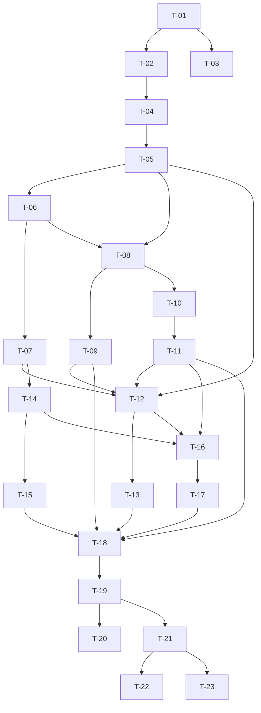

# Implementation Plan — Create a TODO Task

Based on: architecture.md v3, requirements.md v3  
Design review: Round 2 verdict Approve; DR-1, DR-2, and DR-3 resolved. Traceability: docs/traceability.md updated for these approved artifacts.

## 1. Task List

| ID | Group | Title | Description / done-when | Covers | Component | Depends on | Status | Blocked? |
|----|-------|-------|--------------------------|--------|-----------|------------|--------|----------|
| T-01 | P0 | Scaffold browser app and test command | Create the architecture's `src/` and `tests/` layout with plain HTML, CSS, and JavaScript; configure one documented, repeatable test command without adding a runtime framework/backend. Select test tooling only as needed for the specified hermetic DOM/storage tests; pin and justify any dev dependency. Verify the page shell loads and the test command runs. | NFR-7 | Task Page UI; Testing Strategy | — | Todo | No |
| T-02 | P0 | Build hermetic test fixtures | Add isolated DOM and browser-storage fixtures with deterministic records, `getItem`/`setItem` exception injection, and write-call observation. Verify fixtures reset between tests and can model absent, malformed, readable, and unreadable values without network access or real credentials. | NFR-6, NFR-7, NFR-8 | Testing Strategy; Local Storage Adapter | T-01 | Todo | No |
| T-03 | P0 | Establish no-secrets configuration policy | Add `.env.example` containing only a comment that no environment variables are required; do not add credentials or secret-like values. Verify app/build/test output does not print credentials, task titles, or storage exception details, and that no application credential is requested, generated, or persisted. | NFR-8 | Browser-only flow; Feedback Display | T-01 | Todo | No |
| T-04 | P1 | Implement title validator | Implement validation for empty/whitespace-only input and a 255-Unicode-code-point maximum; preserve valid text without trimming or truncation. Return exactly `Task title is required and cannot be empty.` and `Task title must be 255 characters or fewer.` for the respective invalid cases. | FR-4, FR-10, NFR-2, NFR-6 | Title Validator | T-02 | Todo | No |
| T-05 | P1 | Test title validation boundaries | Verify empty, whitespace-only, ordinary valid text, exactly 255 code points, 256 code points, and supplementary Unicode characters. Assert exact messages, valid text preservation, and that validation uses code points rather than UTF-16 string length. | FR-4, FR-10, NFR-2, NFR-7 | Title Validator; Testing Strategy | T-04 | Todo | No |
| T-06 | P1 | Implement in-memory task state and record rules | Add an ordered state owner for `{id, title, status}` records. Accept snapshots/candidates only through explicit state operations; require unique nonempty string IDs, valid 1–255-code-point titles, and `incomplete` status. Preserve same-title tasks with distinct IDs. | FR-3, FR-5, FR-6, FR-8, FR-9, FR-10, NFR-5, NFR-6 | In-Memory Task State | T-05 | Todo | No |
| T-07 | P1 | Test task state invariants | Verify order and snapshot behavior, `incomplete` default/record status, distinct IDs for same-title tasks, and that uncommitted candidates do not alter the current snapshot. | FR-3, FR-5, FR-6, FR-8, NFR-5, NFR-7 | In-Memory Task State; Testing Strategy | T-06 | Todo | No |
| T-08 | P1 | Implement local-storage adapter | Read one JSON array from one origin-local key. Treat absent key as empty; treat read exceptions, empty text, invalid JSON, and non-array top-level values as unreadable. For parseable arrays retain valid distinct records and skip malformed/duplicate-ID records. Stage one complete candidate and call `setItem` once; catch browser exceptions and return safe outcomes without logging details or partially committing UI state. | FR-8, FR-9, FR-10, NFR-5, NFR-6 | Local Storage Adapter | T-05, T-06 | Todo | No |
| T-09 | P1 | Test storage adapter read, recovery, and write behavior | Using fixtures, verify absent/readable/unreadable values, valid distinct record preservation, malformed and duplicate-ID filtering, one-snapshot writes, read/write exception containment, and unchanged stored representation after a failed write. | FR-8, FR-9, NFR-5, NFR-6, NFR-7 | Local Storage Adapter; Testing Strategy | T-08 | Todo | No |
| T-10 | P1 | Implement storage recovery state | Track `WRITES_ALLOWED` versus `BLOCKED_WRITES`. Enter blocked state after unreadable initial load; permit release only after successful reread or a separate explicit user-confirmed replacement action. A failed reread stays blocked; replacement must never be triggered by ordinary Add Task. | FR-8, NFR-6 | Storage Recovery State | T-08 | Todo | No |
| T-11 | P1 | Test storage recovery gate | Verify initial unreadable load blocks writes; failed reread remains blocked; successful reread restores its snapshot and releases the gate; cancellation does not release it; only separate explicit replacement confirmation releases it. | FR-8, NFR-6, NFR-7 | Storage Recovery State; Testing Strategy | T-10 | Todo | No |
| T-12 | P1 | Implement task creation controller | Implement validate → gate check → candidate → one storage write → commit/render result → clear input order. Invalid titles cause no storage access. While blocked, a valid submission does not call `setItem`, preserves input/list, and shows exactly `Saved tasks could not be read. Resolve the issue or confirm replacing saved tasks before adding a task.` A failed write preserves input/list and shows exactly `Unable to save the task. Please try again.` Clear input only after successful persistence. | FR-3–FR-8, FR-10, NFR-2, NFR-3, NFR-6 | Task Creation Controller; Storage Recovery State; In-Memory Task State; Local Storage Adapter; Feedback Display | T-05, T-07, T-09, T-11 | Todo | No |
| T-13 | P1 | Test task creation controller flows | Verify one valid submission creates one incomplete task, commits only after a successful write, and clears input only on success. Verify invalid input performs no write; failed save and blocked-write submission preserve input/list; assert exact required, overlength, unreadable-load, and failed-save messages. | FR-3–FR-8, FR-10, NFR-2, NFR-3, NFR-6, NFR-7 | Task Creation Controller; Testing Strategy | T-12 | Todo | No |
| T-14 | P1 | Implement text-only task list renderer | Render every title using `textContent` or equivalent DOM text APIs and show the `incomplete` status. Render only the committed task snapshot; do not interpolate title content into HTML. | FR-5, FR-6, FR-9, NFR-1, NFR-3 | Task List Renderer | T-07 | Todo | No |
| T-15 | P1 | Test safe task rendering | Seed ordinary and HTML/script-like titles. Assert titles are rendered literally, no executable markup is created or executed, status is visible as `incomplete`, and the renderer reflects the supplied committed snapshot. | FR-5, FR-6, NFR-1, NFR-3, NFR-7 | Task List Renderer; Testing Strategy | T-14 | Todo | No |
| T-16 | P1 | Build task page and responsive controls | Add title input, Add Task button, task list, feedback region, reread action, and a distinct explicit-replacement confirmation action. Implement responsive layout for 320 px portrait and 1280 px desktop; keep controls visible and operable. Use clear confirmation for destructive replacement; do not make replacement an Add Task side effect. | FR-1, FR-2, FR-5, FR-7, NFR-2–NFR-4, NFR-6 | Task Page UI; Responsive Layout; Feedback Display | T-11, T-12, T-14 | Todo | No |
| T-17 | P1 | Test task page controls and responsive layout | Verify input, Add Task, feedback, and recovery controls are present and operable; feedback is visible in the same interaction; replacement requires a distinct confirmation. Check control visibility/operation at 320 px portrait and 1280 px desktop. | FR-1, FR-2, FR-4, FR-5, FR-7, NFR-2–NFR-4, NFR-6, NFR-7 | Task Page UI; Responsive Layout; Testing Strategy | T-16 | Todo | No |
| T-18 | P1 | Wire initial load and application events | Connect initial storage read, recovery state, state owner, renderer, controller, feedback, and UI actions. On refresh restore saved tasks; show the exact unreadable-load message and zero tasks on unreadable whole-value load; show non-destructive partial-recovery feedback when malformed elements are skipped. DR-2: no lookup component or test is in scope; `Not Found` applies only if lookup is introduced later, not to missing persisted records in this create-only flow. | FR-1–FR-10, NFR-1–NFR-3, NFR-5–NFR-7 | Task Page UI; Task Creation Controller; Local Storage Adapter; Storage Recovery State; In-Memory Task State; Task List Renderer; Feedback Display | T-09, T-11, T-13, T-15, T-17 | Todo | No |
| T-19 | P1 | Test integrated create and refresh flow | With isolated browser storage, verify initial page controls, create/list/status/input-clear behavior, exact validation feedback, successful persistence and restoration after one refresh, and feedback/list update within the same interaction. | FR-1–FR-10, NFR-2–NFR-5, NFR-7 | Testing Strategy; Task Page UI; Task Creation Controller; Local Storage Adapter; Task List Renderer | T-18 | Todo | No |
| T-20 | P2 | Exercise storage fault and recovery matrix | Add repeatable fault-injection tests for read exception, empty text, invalid JSON, wrong top-level shape, malformed arrays, duplicate IDs, blocked read-fail-then-write-succeed, successful reread, explicit replacement, and failed write after replacement. Assert zero tasks for unreadable whole values, valid-record retention for partial corruption, exact messages, no crash, no blocked `setItem`, and atomic failed writes. | FR-8, FR-9, NFR-5, NFR-6, NFR-7 | Local Storage Adapter; Storage Recovery State; Task Creation Controller; Testing Strategy | T-19 | Todo | No |
| T-21 | P2 | Verify browser security and viewport acceptance | Run browser-level checks with HTML/script-like titles, desktop/mobile viewport targets, and a real refresh using isolated test-origin storage. Confirm no title script executes, the 320 px and 1280 px controls remain operable, and every successfully saved task is restored after one refresh. | FR-5, FR-9, NFR-1, NFR-4, NFR-5, NFR-7 | Task List Renderer; Responsive Layout; Local Storage Adapter; Testing Strategy | T-19 | Todo | No |
| T-22 | P3 | Write README | Document local launch and test commands, browser-only scope, task behavior, storage limitations/recovery controls, and the absence of required environment variables or credentials. Do not include real or illustrative secrets. | NFR-4, NFR-6, NFR-7, NFR-8 | Documentation | T-21 | Todo | No |
| T-23 | P3 | Add CHANGELOG | Add an initial changelog entry describing the delivered create-task behavior and its approved scope; do not claim lookup, `Not Found`, editing, deletion, or completion behavior. | FR-1–FR-10, NFR-1–NFR-8 | Documentation | T-21 | Todo | No |

Output-document generation/validation: Not applicable. Architecture v3 specifies an interactive browser TODO application and no generated output document; validate the rendered task list and browser UI through the test tasks above.

## 2. Dependency Graph

## 3. Blocked Tasks

| Task | Blocked until | Reason |
|------|---------------|--------|
| None | — | Approved requirements v3 and architecture v3 define the implementation scope; design-review Round 2 resolved DR-1/DR-2/DR-3. Test tooling is intentionally selected in T-01 within architecture constraints, so it does not block the plan. |

## 4. Critical Path

T-01 → T-02 → T-04 → T-05 → T-06 → T-08 → T-09 → T-12 → T-13 → T-18 → T-19 → T-21 → T-22/T-23.

The critical feature sequence includes the storage recovery gate branch (T-10 → T-11 → T-12); T-12 cannot complete until both that branch and the adapter/state tests are complete.

## 5. Test Strategy per Task Group

- **P0 — Foundation:** Verify the test command runs; fixtures are isolated and can inject storage failures; configuration contains no credentials; `.env.example` states that no variables are required. No network access or real credentials.
- **P1 — Core features:** Unit-test validator, task state, storage adapter, recovery gate, controller, and renderer independently. Test page controls and integrated create/refresh behavior with hermetic DOM and browser-storage fixtures. Assert exact messages and state/input effects.
- **P2 — Hardening / edge cases:** Run the full storage fault-injection and DR-1 sequence, browser security checks, and 320 px / 1280 px / refresh acceptance checks. Verify malformed-array recovery, safe text rendering, no crash, and atomic write failure.
- **P3 — Docs / polish:** Check README commands against the configured test workflow and review README/CHANGELOG claims against requirements v3 and the no-lookup scope. Verify no secrets are present in documentation or output.

## 6. Risks to Delivery

- **Accepted cross-tab concurrency risk:** Multiple tabs can replace the same localStorage key concurrently and may lose concurrent updates. Cross-tab synchronization/conflict resolution is explicitly outside scope; do not add speculative synchronization.
- **Destructive explicit replacement:** Confirmed replacement can discard unreadable saved tasks. Keep it as a clearly separate, explicit user action; never invoke it automatically or through ordinary Add Task.
- **Browser storage availability:** Privacy settings, quota, or browser policy can make storage unreadable/unwritable. Adapter failures must remain contained and use fixed user-facing messages.
- **Unicode consistency:** Creation and restored-record checks must count Unicode code points consistently; UTF-16 `.length` alone is not sufficient.
- **Test environment selection:** Architecture does not mandate a test runner/browser harness. T-01 must select the smallest repeatable approach that supports the approved hermetic and browser checks, without introducing runtime framework dependencies.
- **Upstream architecture ambiguity:** architecture.md §4 and §12 contain a separately identified conflict. This plan does not attempt to resolve it; implementation should follow the approved upstream requirements and architecture reviews until the architecture artifact is reconciled.

## OPEN QUESTIONS

None. Architecture v3 §11 states: “Open questions: None.” No upstream ambiguity blocks planning; test tooling selection is delegated to T-01.

## 7. Requirement → Task Coverage

| Requirement | Tasks |
|-------------|-------|
| FR-1 | T-16, T-17, T-18, T-19, T-23 |
| FR-2 | T-16, T-17, T-18, T-19, T-23 |
| FR-3 | T-06, T-07, T-12, T-13, T-18, T-19, T-23 |
| FR-4 | T-04, T-05, T-12, T-13, T-17, T-18, T-19, T-23 |
| FR-5 | T-06, T-07, T-12, T-13, T-14, T-15, T-16, T-17, T-18, T-19, T-21, T-23 |
| FR-6 | T-06, T-07, T-12, T-13, T-14, T-15, T-18, T-19, T-23 |
| FR-7 | T-12, T-13, T-16, T-17, T-18, T-19, T-23 |
| FR-8 | T-06, T-07, T-08, T-09, T-10, T-11, T-12, T-13, T-18, T-19, T-20, T-23 |
| FR-9 | T-06, T-08, T-09, T-14, T-18, T-19, T-20, T-21, T-23 |
| FR-10 | T-04, T-05, T-06, T-08, T-12, T-13, T-18, T-19, T-23 |
| NFR-1 | T-14, T-15, T-18, T-21, T-23 |
| NFR-2 | T-04, T-05, T-12, T-13, T-16, T-17, T-18, T-19, T-23 |
| NFR-3 | T-12, T-13, T-14, T-15, T-16, T-17, T-18, T-19, T-23 |
| NFR-4 | T-16, T-17, T-19, T-21, T-22, T-23 |
| NFR-5 | T-06, T-07, T-08, T-09, T-18, T-19, T-20, T-21, T-23 |
| NFR-6 | T-02, T-04, T-06, T-08, T-09, T-10, T-11, T-12, T-13, T-16, T-17, T-18, T-20, T-22, T-23 |
| NFR-7 | T-01, T-02, T-05, T-07, T-09, T-11, T-13, T-15, T-17, T-18, T-19, T-20, T-21, T-22, T-23 |
| NFR-8 | T-02, T-03, T-22, T-23 |
