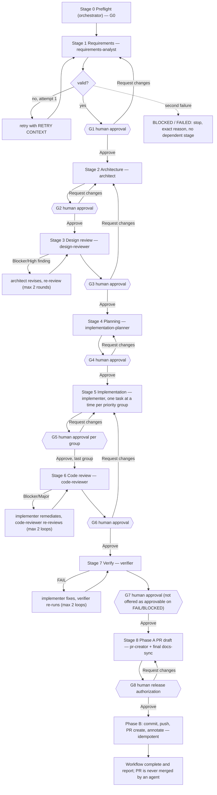
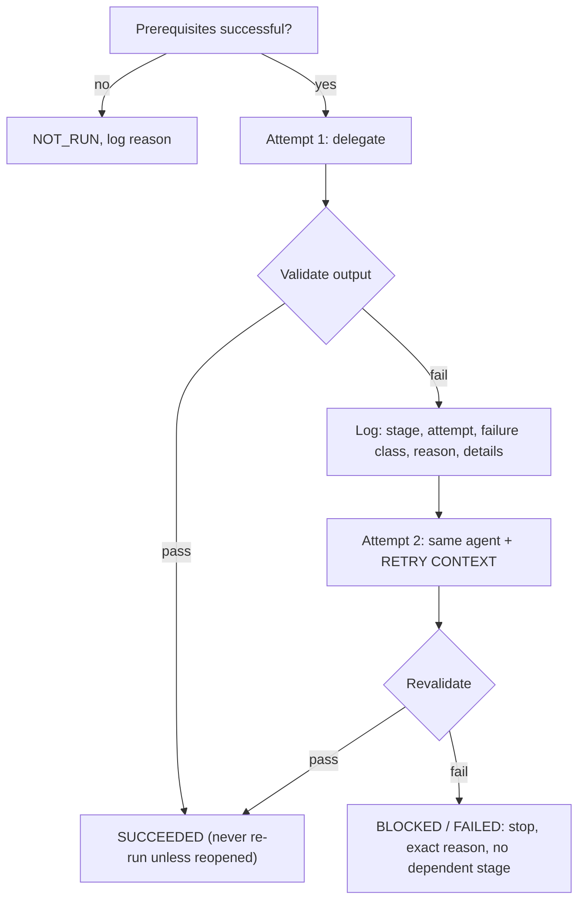

# SDLC Orchestrator — Stage Reference

Based on: `.github/agents/sdlc-orchestrator.agent.md` (authoritative runtime source)   Version: 1   Status: Draft

This document describes every stage of the Agentic SDLC. If it disagrees with the orchestrator agent file, the agent file wins and this document must be corrected (`docs-sync` and `scripts/validate-sdlc-config.mjs` help catch drift).

## 1. Three levels

| Level | Where defined | Responsibility |
|-------|---------------|----------------|
| **Orchestrator** | `.github/agents/sdlc-orchestrator.agent.md` | Controls stage sequence, delegation, transitions, validation, retries, human approval gates, `.sdlc/state.md`, `.sdlc/retry-log.md`. Writes no requirements, designs or code. |
| **Agent** | `.github/agents/<name>.agent.md` | Executes one assigned responsibility and owns one artifact. Returns a report; asks `OPEN QUESTIONS` instead of guessing. |
| **Skill / instruction** | `.github/skills/*/SKILL.md`, `.github/instructions/*.md` | Reusable domain knowledge and standards (what "good" looks like). Contains no workflow control. |

Configured agents: `sdlc-orchestrator`, `requirements-analyst`, `architect`, `design-reviewer`, `implementation-planner`, `implementer`, `code-reviewer`, `verifier`, `docs-sync`, `pr-creator`. No other agents exist.

Configured skills: `user-story-intake`, `requirements-analysis`, `architecture-design`, `js-implementation`, `code-review`, `testing-strategy`, `verification`, `docs-sync-check`, `pr-authoring`.

## 2. Flow



Every stage box is wrapped by the same execution loop (section 4). The diagram draws it once (Stage 1) to stay readable.

## 3. Stage reference

Mapping of the 18 workflow steps to stages: 1 → Stage 0; 2–3 → Stage 1 + G1; 4, 7 → Stage 2 + G2; 5, 6 → Stage 3 (+ architect loop-back) + G3; 8–9 → Stage 4 + G4; 10 → Stage 5 + G5; 11–12 → Stage 6 + G6; 13–14 → Stage 7 + G7; 15 → Stage 8 Phase A; 16 → G8; 17 → Stage 8 Phase B; 18 → Finish. `docs-sync` runs after every stage.

Common to all stages: **Failure handling** = the retry loop in section 4 (2 attempts, then `BLOCKED`/`FAILED`); **Next stage** runs only when this stage is `APPROVED`/`SUCCEEDED`.

### Stage 0 — Workflow initiation and user input (step 1)
| Item | Definition |
|------|------------|
| Purpose | Find the user story, confirm git state, create the feature branch and state files |
| Responsible | `sdlc-orchestrator` (with `user-story-intake` skill) |
| Inputs | File in `user-story/`, pasted story, or JIRA/Confluence key via an available MCP tool |
| Outputs | `user-story/_extracted.md`, `.sdlc/state.md`, `.sdlc/retry-log.md`, branch `feature/<slug>` |
| Preconditions | Workspace is a git repository (else ask before `git init`); not on `main`/`master` |
| Validation | Story text non-empty; branch is not `main`/`master`; state and retry-log exist |
| Next | Stage 1 |
| Human approval | **G0** (story source, slug, branch, stage list). Resume/Restart choice if state exists |
| Stage-specific failure | No story found → stop and tell the human to add one (not retried; nothing to retry) |

### Stage 1 — Requirement analysis (step 2) and approval (step 3)
| Item | Definition |
|------|------------|
| Purpose | Turn the story into testable FR/NFR with Given/When/Then criteria |
| Responsible | `requirements-analyst` (skills: `requirements-analysis`, `user-story-intake`) |
| Inputs | `user-story/_extracted.md`, prior human answers |
| Outputs | `docs/requirements.md`; `docs/traceability.md` (docs-sync) |
| Preconditions | G0 approved |
| Validation | Sections 1–9 present; every FR has Given/When/Then; every NFR measurable; unique IDs; no `TBD` |
| Next | Stage 2 |
| Human approval | **G1**; *Request changes* → revision cycle (analyst re-invoked with feedback) |
| Notes | `OPEN QUESTIONS` → clarification loop (max 3 rounds), not a failure |

### Stage 2 — Architecture design (step 4) and approval (step 7)
| Item | Definition |
|------|------------|
| Purpose | Components, technology choices, data flow, error handling, security |
| Responsible | `architect` (skill: `architecture-design`) |
| Inputs | Approved `docs/requirements.md`; existing code/config |
| Outputs | `docs/architecture.md` |
| Preconditions | G1 approved |
| Validation | Template sections present; every FR/NFR in §12; ≥2 options per significant choice; Mermaid fences balanced |
| Next | Stage 3 |
| Human approval | **G2** (architecture approval); *Request changes* → revision cycle with `architect` |

### Stage 3 — Design review (step 5) and architecture revision (step 6)
| Item | Definition |
|------|------------|
| Purpose | Find design risks before any code exists |
| Responsible | `design-reviewer` reviews; `architect` revises |
| Inputs | `docs/requirements.md`, `docs/architecture.md` |
| Outputs | `docs/design-review.md` (rounds), revised `docs/architecture.md` with revision history |
| Preconditions | Architecture exists and passed Stage 2 validation |
| Validation | Round section, every finding has severity + evidence + recommendation, every lens answered, verdict present |
| Loop | Blocker/High finding → architect revises → one re-review; after two rounds remaining items go to the human |
| Next | Stage 4 |
| Human approval | **G3** (accepts the review outcome and the revised architecture; a change request returns to `architect`, then re-review) |

### Stage 4 — Implementation planning (step 8) and approval (step 9)
| Item | Definition |
|------|------------|
| Purpose | Dependency-ordered, traceable task list in priority groups |
| Responsible | `implementation-planner` (skills: `architecture-design`, `requirements-analysis`, `testing-strategy`) |
| Inputs | Requirements, architecture, design review |
| Outputs | `docs/impl-plan.md` |
| Preconditions | G3 approved |
| Validation | Every FR/NFR in §7; every `Depends on` resolves; no cycles; code tasks have test criteria |
| Next | Stage 5 |
| Human approval | **G4** |

### Stage 5 — Task-wise implementation (step 10)
| Item | Definition |
|------|------------|
| Purpose | Code and tests, one task at a time, one priority group per gate |
| Responsible | `implementer` (skills: `js-implementation`, `testing-strategy`; instructions `code`, `testing`, `security`) |
| Inputs | `docs/impl-plan.md` task row, architecture components, requirements |
| Outputs | Files under `src/`, `tests/`; task Status `Done` in the plan; implementer report with real test output |
| Preconditions | G4 approved; the task's `Depends on` tasks are `Done` (a blocked task is reported, never worked around) |
| Validation | Per task: files exist, test command actually ran with counts and passes, no secret-like strings, plan status updated by implementer only |
| Retry scope | **Per task** (`T-nn`), not per group; a succeeded task is not re-run when a later task fails |
| Next | Next task / next group; Stage 6 after the last group |
| Human approval | **G5** per priority group (diff stat + test output) |

### Stage 6 — Code review (step 11) and remediation / re-review (step 12)
| Item | Definition |
|------|------------|
| Purpose | Peer review against a 15-area checklist |
| Responsible | `code-reviewer` (skill: `code-review`); remediation by `implementer` delegated **by the orchestrator** |
| Inputs | Requirements, architecture, plan, `git diff <base>...HEAD`, tests |
| Outputs | `docs/code-review.md` (findings `CR-n`, severities Blocker/Major/Minor/Suggestion, `file:line` evidence, verdict) |
| Preconditions | All G5 groups approved |
| Validation | All 15 areas covered; every finding has `file:line`; verdict present; reviewer changed no file except the report |
| Loop | Blocker/Major → orchestrator hands findings to `implementer` → `code-reviewer` re-reviews (max 2 remediation loops) |
| Next | Stage 7 |
| Human approval | **G6** |

### Stage 7 — Independent verification and testing (step 13), verification approval (step 14)
| Item | Definition |
|------|------------|
| Purpose | Prove behaviour by running the suite; trace acceptance criteria to tests |
| Responsible | `verifier` (skills: `verification`, `testing-strategy`, `docs-sync-check`) |
| Inputs | Requirements, plan, code, tests |
| Outputs | `docs/verification-report.md` with raw output and `PASS`/`FAIL`/`BLOCKED` |
| Preconditions | G6 approved |
| Validation | Commands actually run this session; pasted output; criteria → test table; only `tests/` and the report changed |
| Loop | `FAIL` → implementer fixes → verifier re-runs (max 2). `BLOCKED` → human |
| Next | Stage 8 |
| Human approval | **G7**; not presented as approvable while `FAIL`/`BLOCKED` ("where applicable") |

### Stage 8 — PR preparation (step 15), release authorization (step 16), commit/push/PR (step 17), completion (step 18)
| Item | Definition |
|------|------------|
| Purpose | Package the work into a PR with an AI disclosure and publish it only after human authorization |
| Responsible | `pr-creator` (skill: `pr-authoring`), final `docs-sync` |
| Inputs | All `docs/*.md`, `git log`/`git diff`, verification report |
| Outputs | Phase A: `docs/pr-description.md` (AI-disclosure + five sections + reviewer checklist), `CHANGELOG.md`. Phase B: pushed branch, one PR whose body contains the disclosure, optional single disclosure comment |
| Preconditions | G7 approved; `final-scope` docs-sync `in sync`; Phase B only after **G8** |
| Validation | Phase A: disclosure present, every diff file listed, changelog updated. Phase B: each sub-step confirmed by reading real remote state |
| Side-effect safety | Commit/push/PR/annotate/comment are separate idempotent sub-steps (check first, skip if done, never duplicate, never force-push, never merge) |
| Next | Finish: print PR link, final stage table, artifacts, limitations; state `COMPLETE` |
| Human approval | **G8** release authorization. Merging is always a human action |

### docs-sync (cross-cutting)
Runs in `stage-scope` after each stage and `final-scope` before G8 under the same retry loop. Mechanical drift is fixed; semantic conflicts are reported to the human, never auto-resolved.

## 4. Stage execution loop and retry policy

Applies to every stage unit (each stage, each Stage 5 task, each docs-sync run, each Stage 8 publish sub-step).



- **Max attempts: 2.** Counters persist in `.sdlc/retry-log.md` and `.sdlc/state.md`.
- **Technical failure** (retryable): agent error/timeout/empty result, missing or malformed artifact, validation criteria not met, a hook denial caused by the agent's own action.
- **Not technical failures** (do not consume retries): `OPEN QUESTIONS`; human *Request changes*; negative review/verification *results* (handled by the bounded remediation loops); Abort.
- **Human revision cycle:** feedback is recorded verbatim → owning agent revises → output validated (fresh 2-attempt technical budget) → docs-sync → the **same gate is presented again**. Never bypassed or auto-approved; the technical limit does not cap human revisions.
- **Side effects:** reconcile first (read remote state), retry only the missing sub-step. Details and the check table are in the agent file.
- **Retry log columns:** time, stage unit, attempt, outcome, failure class, failure reason/details, retry result, final status.
- **Limitation:** Copilot custom agents expose no retry/timeout property. The loop is instruction-enforced by the orchestrator, evidenced by `.sdlc/retry-log.md`, and is not an engine guarantee. No fictional configuration properties are used.

## 5. Gate format (unchanged)
```
GATE Gn — <stage name>
Artifact(s): <paths>
Summary: <3-5 bullets>
Open risks / assumptions: <bullets or "none">
Docs-sync: <in sync | N fixes applied | N unresolved>
Decision needed: [Approve] [Request changes: <what>] [Abort]
```
Silence is never approval. Approve commits only the stage's specific files.

## 6. Revision history
| Version | Date | Change |
|---------|------|--------|
| 1 | 2026-11-26 | Created from the orchestrator agent file; added retry policy, validation criteria, side-effect safety |
